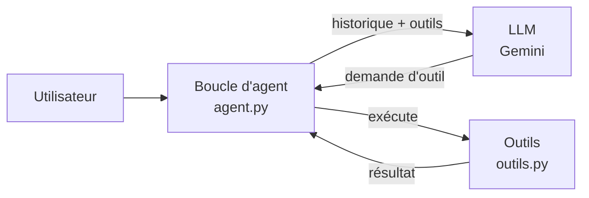

# Agent IA de recherche d'alternance

Agent IA autonome en Python qui **recherche des offres d'alternance**, les **compare à mon CV**, les **note** selon une grille de critères et **met à jour mon tableau de suivi** de candidatures, après ma validation.

Projet personnel réalisé pendant ma recherche d'alternance, pour apprendre à construire un agent IA de A à Z, sans framework.

---

## Ce que fait l'agent

| Mode | Commande | Ce qui se passe |
|---|---|---|
| **Recherche** | `python agent.py` | L'agent lit le CV, choisit lui-même les métiers à chercher, interroge l'API La bonne alternance, écarte les offres hors profil, note les autres et propose les meilleures pour le tableau de suivi |
| **Analyse** | `python agent.py offre.txt` | L'agent analyse une offre précise par rapport au CV et donne un score détaillé |

Pour chaque offre retenue, l'agent fournit :
- un **score sur 10**, détaillé critère par critère ;
- les **compétences déjà acquises** et celles **à développer** ;
- **2 arguments** pour la lettre de motivation.

---

## Comment ça marche

Un agent IA repose sur trois éléments :

- **Le LLM (Gemini)** : le « cerveau ». Il comprend, raisonne et décide de la prochaine action. Il ne peut rien exécuter lui-même.
- **Les outils** : des fonctions Python que le LLM peut demander d'utiliser (lire un fichier, appeler une API, écrire dans Excel).
- **La boucle** : le code qui exécute les outils demandés et renvoie les résultats au LLM, jusqu'à ce que la tâche soit terminée.



C'est le LLM qui décide **quels outils utiliser et dans quel ordre**. Le prompt définit seulement l'objectif, la grille de notation et les règles. C'est ce qui distingue un agent d'un simple workflow.

### Les outils

| Outil | Rôle |
|---|---|
| `lire_cv` | Extrait le texte du CV (PDF ou texte) |
| `lire_offre` | Lit une offre enregistrée dans un fichier texte |
| `chercher_offres` | Recherche des offres en alternance via l'API La bonne alternance, à partir de codes métiers ROME |
| `verifier_doublon` | Vérifie si l'entreprise figure déjà dans le tableau de suivi |
| `ajouter_au_tableau` | Ajoute l'offre dans le tableau Excel de suivi des candidatures |

---

## La sécurité et la fiabilité

Un agent qui agit dans le monde réel doit être encadré. Ce projet met en place plusieurs garde-fous :

- **Validation humaine** : toute écriture dans le tableau de suivi demande une confirmation explicite avant d'être exécutée.
- **Journal des actions tenu par le code** : à la fin de chaque exécution, le programme affiche les outils réellement appelés. On ne se fie jamais au récapitulatif du LLM, qui peut annoncer une action qu'il n'a pas faite.
- **Protection contre l'injection de prompt** : le texte des offres est traité comme une donnée, jamais comme une instruction.
- **Gestion des erreurs** : un outil en échec renvoie un message d'erreur lisible au lieu de faire planter le programme, et l'agent s'arrête au lieu d'inventer des informations.
- **Limite de tours** : la boucle s'arrête après un nombre maximal d'étapes pour éviter qu'un agent ne tourne indéfiniment.
- **Secrets hors du code** : les clés d'API sont stockées dans un fichier `.env` exclu du dépôt Git.

---

## Technologies

- **Python 3.10+**
- **Google Gemini** (`google-genai`) : LLM avec appel d'outils (*function calling*)
- **API La bonne alternance** : offres d'alternance publiques et en temps réel
- **pypdf** : lecture du CV
- **openpyxl** : lecture et écriture du tableau de suivi Excel
- **requests** : appels HTTP
- **python-dotenv** : gestion des secrets

---

## Installation

```bash
git clone https://github.com/shahilsamsudeen/agent-alternance.git
cd agent-alternance
python3 -m venv .venv
source .venv/bin/activate
pip install -r requirements.txt
```

### Configuration

1. Crée une clé API Gemini sur [Google AI Studio](https://aistudio.google.com/apikey).
2. Crée un compte sur [api.apprentissage.beta.gouv.fr](https://api.apprentissage.beta.gouv.fr) et génère une clé d'API de **production**.
3. Crée un fichier `.env` à la racine du projet :

```
GEMINI_API_KEY=ta_cle_gemini
LBA_API_TOKEN=ta_cle_la_bonne_alternance
```

4. Place à la racine du projet :
   - ton CV sous le nom `cv.pdf` ;
   - ton tableau de suivi Excel `Tableau_de_bord_Bachelor2.xlsx`, avec un onglet `Candidatures`.

Le tableau est reconnu grâce aux titres de ses colonnes (Date, Méthode, Lien, Poste, Entreprise, Statut, Commentaire…). Si les titres ne sont pas sur la première ligne, ajuste `LIGNE_ENTETE` dans `outils.py`.

> Teste d'abord l'agent sur une **copie** de ton tableau, et ferme le fichier dans Excel avant de lancer l'agent.

---

## ▶Utilisation

```bash
# Recherche autonome d'offres
python agent.py

# Analyse d'une offre enregistrée dans un fichier
python agent.py offre.txt
```

Exemple de déroulé en mode recherche :

```
--- Tour 1 ---
🔧 L'agent appelle lire_cv({'chemin': 'cv.pdf'})
   ✅ ok
--- Tour 2 ---
🔧 L'agent appelle chercher_offres({'codes_rome': 'M1805,M1810,M1801', 'rayon_km': 60, 'nombre': 20})
   ✅ ok
--- Tour 3 ---
🔧 L'agent appelle verifier_doublon({'entreprise': '...'})
   ✅ ok
--- Tour 4 ---
🔧 L'agent appelle ajouter_au_tableau({...})
   L'agent veut écrire cette ligne dans ton tableau :
   ...
   Tu valides ? (o/n)
```

---

## Structure du projet

```
agent-alternance/
├── agent.py           # Consignes du LLM, boucle d'agent, validation humaine, journal
├── outils.py          # Fonctions outils et leurs déclarations pour le LLM
├── requirements.txt   # Dépendances Python
└── .gitignore         # Exclut .env, le CV, le tableau Excel et l'environnement virtuel
```

---

## Ce que j'ai appris

- Le fonctionnement interne d'un agent : boucle de raisonnement, appel d'outils, gestion de l'historique (un LLM n'a pas de mémoire entre deux appels).
- L'importance des **descriptions d'outils** : le LLM ne voit jamais le code, seulement ces descriptions.
- Les limites des LLM et comment les compenser par du code : **actions hallucinées**, erreurs de calcul, informations inventées.
- L'intégration d'API REST et la lecture de réponses JSON imbriquées.
- Les bonnes pratiques de sécurité : secrets, validation humaine, injection de prompt.

---

## Pistes d'amélioration

- Lancement automatique chaque matin, avec envoi du classement sur Telegram
- Génération d'un brouillon de lettre de motivation pour les offres validées
- Recherche d'entreprises susceptibles de recruter, pour les candidatures spontanées
- Calcul du score par le code plutôt que par le LLM

---

## 👤 Auteur

**Shahil Samsudeen**, étudiant en DEUST IOSI au Cnam de Paris.

[Portfolio](https://shahilsamsudeen.github.io/shahilpro/) · [GitHub](https://github.com/shahilsamsudeen)
